# 4.2. Landing Page & Mobile Application Implementation

## 4.2.2. Sprint 2

### 4.2.2.1. Sprint Planning 2

  <table style="margin: auto; width: 100%; border-collapse: collapse; text-align: left;">
    <thead>
      <tr>
        <th colspan="2" style="text-align: center; background-color: #f2f2f2; font-size: 1.2em; padding: 10px; border: 1px solid #ddd;">Sprint #2</th>
      </tr>
    </thead>
    <tbody>
      <tr>
        <td colspan="2" style="background-color: #fafafa; font-weight: bold; text-align: center; padding: 10px; border: 1px solid #ddd;">Sprint Planning Background</td>
      </tr>
      <tr>
        <td style="width: 30%; font-weight: bold; padding: 10px; border: 1px solid #ddd;">Date</td>
        <td style="padding: 10px; border: 1px solid #ddd;">2026-19-05</td>
      </tr>
      <tr>
        <td style="font-weight: bold; padding: 10px; border: 1px solid #ddd;">Time</td>
        <td style="padding: 10px; border: 1px solid #ddd;">3:30 PM</td>
      </tr>
      <tr>
        <td style="font-weight: bold; padding: 10px; border: 1px solid #ddd;">Location</td>
        <td style="padding: 10px; border: 1px solid #ddd;">Reunión presencial en la UPC (Pabellón L, piso 3, cubículo 6) y sesión síncrona vía Microsoft Teams.</td>
      </tr>
      <tr>
        <td style="font-weight: bold; padding: 10px; border: 1px solid #ddd;">Prepared By</td>
        <td style="padding: 10px; border: 1px solid #ddd;">Mamani Vilca, Alan Jaivi</td>
      </tr>
      <tr>
        <td style="font-weight: bold; padding: 10px; border: 1px solid #ddd;">Attendees (to planning meeting)</td>
        <td style="padding: 10px; border: 1px solid #ddd;">Machacca Soto, Aldo Jeanfranco / Mallqui Vilca, Dhilsen Armil / Mamani Vilca, Alan Jaivi / Ramos Hinostroza, Diego Antonio / Vidal Malaga, Jareth Beycker</td>
      </tr>
      <tr>
        <td style="font-weight: bold; padding: 10px; border: 1px solid #ddd;">Sprint 1 Review Summary</td>
        <td style="padding: 10px; border: 1px solid #ddd;">Durante el Sprint 1, el equipo TuxLogic desplegó con éxito la Landing Page comercial en Vercel y completó la base de la plataforma RESTful backend (<code>shiftiq-platform</code>) con Spring Boot 3.5.5, PostgreSQL 18, autenticación JWT, documentación OpenAPI/Swagger UI y pruebas unitarias automatizadas.</td>
      </tr>
      <tr>
        <td style="font-weight: bold; padding: 10px; border: 1px solid #ddd;">Sprint 1 Retrospective Summary</td>
        <td style="padding: 10px; border: 1px solid #ddd;">Se acordó desarrollar e implementar de forma especializada los dos aplicativos móviles clientes del ecosistema: <strong>ShiftIQ Workshop App en Flutter</strong> para el <strong>Segmento 1 (Dueños y administradores de talleres automotrices)</strong> y <strong>ShiftIQ Driver App en Kotlin/Android nativo</strong> para el <strong>Segmento 2 (Conductores particulares con vinculación IoT OBD-II)</strong>, ambos consumiendo la plataforma backend RESTful desplegada.</td>
      </tr>
      <tr>
        <td colspan="2" style="background-color: #fafafa; font-weight: bold; text-align: center; padding: 10px; border: 1px solid #ddd;">Sprint Goal & User Stories</td>
      </tr>
      <tr>
        <td style="font-weight: bold; padding: 10px; border: 1px solid #ddd;">Sprint 2 Goal</td>
        <td style="padding: 10px; border: 1px solid #ddd;">
          <strong>Our focus is on</strong> developing and deploying the first functional release of the dual mobile client applications for ShiftIQ: the <strong>Workshop Mobile App built with Flutter</strong> for Segment 1 (Workshop administration, branch management, mechanic staff roles, and work order tracking) and the <strong>Driver Mobile App built with native Kotlin (Android Jetpack Compose)</strong> for Segment 2 (Vehicle garage, Bluetooth OBD-II device pairing, DTC telemetry alerts, and service appointment booking).  
          <strong>We believe it delivers</strong> tailored, touch-optimized, and testable mobile client experiences for both sides of the market, seamlessly synchronizing vehicle telematics and workshop operational workflows through the deployed Spring Boot RESTful API.  
          <strong>This will be confirmed when</strong> both mobile applications connect in real time to the cloud backend endpoints, execute their respective end-to-end user journeys without mock simulation, pass their automated unit/widget test suites, and generate signed release APKs on GitHub Releases.
        </td>
      </tr>
      <tr>
        <td style="font-weight: bold; padding: 10px; border: 1px solid #ddd;">Sprint 2 Velocity</td>
        <td style="padding: 10px; border: 1px solid #ddd;">42 Story Points</td>
      </tr>
      <tr>
        <td style="font-weight: bold; padding: 10px; border: 1px solid #ddd;">Sum of Story Points</td>
        <td style="padding: 10px; border: 1px solid #ddd;">42 Story Points (US001: 5, US002: 3, US005: 5, US006: 3, US008: 3, US012: 5, US013: 3, US014: 5, US017: 3, US018: 5, US026: 2).</td>
      </tr>
    </tbody>
  </table>

---

### 4.2.2.2. Aspect Leaders and Collaborators

En el presente Sprint 2, el alcance de <b>ShiftIQ</b> comprende la construcción simultánea de las dos soluciones móviles nativas/híbridas especializadas por segmento y su enlace con la plataforma backend RESTful. Las responsabilidades del equipo TuxLogic se estructuraron en cuatro frentes:

1. **Flutter Mobile App (Segmento 1 - Talleres B2B):** Liderado por **Mallqui Vilca, Dhilsen Armil** en colaboración con **Vidal Malaga, Jareth Beycker**, abarca el desarrollo en Dart/Flutter de las interfaces de gestión de talleres, sucursales, mecánicos, apertura de órdenes de trabajo y control de tareas operativas.
2. **Kotlin Mobile App (Segmento 2 - Conductores B2C):** Liderado por **Mamani Vilca, Alan Jaivi**, enfocado en la aplicación nativa en Kotlin (Jetpack Compose), integración de hardware telemático OBD-II por Bluetooth, monitoreo de alertas DTC en tiempo real y agendamiento de citas.
3. **Backend API Integration & Security Endpoints:** Liderado por **Machacca Soto, Aldo Jeanfranco**, responsable de la autenticación JWT, control de acceso basado en roles (RBAC con `@PreAuthorize`), compatibilidad CORS y consumo de endpoints de vehículos, talleres y órdenes.
4. **DevOps, QA & Mobile Build Deployment:** Liderado por **Ramos Hinostroza, Diego Antonio**, comprende la automatización de CI/CD en GitHub Actions para compilar y firmar tanto el APK de Flutter como el APK nativo de Kotlin, suites de pruebas unitarias y publicación de versiones estables en GitHub Releases.

  <table style="margin: auto; width: 100%; border-collapse: collapse; text-align: center; font-size: 12px;">
    <thead>
      <tr style="background-color: #f2f2f2;">
        <th style="padding: 10px; border: 1px solid #ddd; text-align: left;">Team Member (Last Name, First Name)</th>
        <th style="padding: 10px; border: 1px solid #ddd;">GitHub Username</th>
        <th style="padding: 10px; border: 1px solid #ddd;">Flutter App (Taller B2B) <small>Leader (L) / Collaborator (C)</small></th>
        <th style="padding: 10px; border: 1px solid #ddd;">Kotlin App (Conductor B2C) <small>Leader (L) / Collaborator (C)</small></th>
        <th style="padding: 10px; border: 1px solid #ddd;">Backend API Integration <small>Leader (L) / Collaborator (C)</small></th>
        <th style="padding: 10px; border: 1px solid #ddd;">DevOps & Mobile QA <small>Leader (L) / Collaborator (C)</small></th>
      </tr>
    </thead>
    <tbody>
      <tr>
        <td style="padding: 10px; border: 1px solid #ddd; text-align: left;">Mamani Vilca, Alan Jaivi</td>
        <td style="padding: 10px; border: 1px solid #ddd;"><code>alanjm-pe</code></td>
        <td style="padding: 10px; border: 1px solid #ddd; color: #1976d2;">C</td>
        <td style="padding: 10px; border: 1px solid #ddd; font-weight: bold; color: #2e7d32;">L</td>
        <td style="padding: 10px; border: 1px solid #ddd; color: #1976d2;">C</td>
        <td style="padding: 10px; border: 1px solid #ddd; color: #1976d2;">C</td>
      </tr>
      <tr>
        <td style="padding: 10px; border: 1px solid #ddd; text-align: left;">Mallqui Vilca, Dhilsen Armil</td>
        <td style="padding: 10px; border: 1px solid #ddd;"><code>Dhilsen18</code></td>
        <td style="padding: 10px; border: 1px solid #ddd; font-weight: bold; color: #2e7d32;">L</td>
        <td style="padding: 10px; border: 1px solid #ddd; color: #1976d2;">C</td>
        <td style="padding: 10px; border: 1px solid #ddd; color: #1976d2;">C</td>
        <td style="padding: 10px; border: 1px solid #ddd; color: #1976d2;">C</td>
      </tr>
      <tr>
        <td style="padding: 10px; border: 1px solid #ddd; text-align: left;">Machacca Soto, Aldo Jeanfranco</td>
        <td style="padding: 10px; border: 1px solid #ddd;"><code>AldoMachacca</code></td>
        <td style="padding: 10px; border: 1px solid #ddd; color: #1976d2;">C</td>
        <td style="padding: 10px; border: 1px solid #ddd; color: #1976d2;">C</td>
        <td style="padding: 10px; border: 1px solid #ddd; font-weight: bold; color: #2e7d32;">L</td>
        <td style="padding: 10px; border: 1px solid #ddd; color: #1976d2;">C</td>
      </tr>
      <tr>
        <td style="padding: 10px; border: 1px solid #ddd; text-align: left;">Ramos Hinostroza, Diego Antonio</td>
        <td style="padding: 10px; border: 1px solid #ddd;"><code>DiegoRamosH</code></td>
        <td style="padding: 10px; border: 1px solid #ddd; color: #1976d2;">C</td>
        <td style="padding: 10px; border: 1px solid #ddd; color: #1976d2;">C</td>
        <td style="padding: 10px; border: 1px solid #ddd; color: #1976d2;">C</td>
        <td style="padding: 10px; border: 1px solid #ddd; font-weight: bold; color: #2e7d32;">L</td>
      </tr>
      <tr>
        <td style="padding: 10px; border: 1px solid #ddd; text-align: left;">Vidal Malaga, Jareth Beycker</td>
        <td style="padding: 10px; border: 1px solid #ddd;"><code>Jareth-18</code></td>
        <td style="padding: 10px; border: 1px solid #ddd; font-weight: bold; color: #2e7d32;">L</td>
        <td style="padding: 10px; border: 1px solid #ddd; color: #1976d2;">C</td>
        <td style="padding: 10px; border: 1px solid #ddd; color: #1976d2;">C</td>
        <td style="padding: 10px; border: 1px solid #ddd; color: #1976d2;">C</td>
      </tr>
    </tbody>
  </table>

---

### 4.2.2.3. Sprint Backlog 2

El presente Sprint Backlog detalla la descomposición técnica de las historias de usuario priorizadas para este ciclo, asignadas entre la aplicación móvil en Flutter (Taller B2B), la aplicación móvil en Kotlin (Conductor B2C) y los servicios de backend:

  <h5 style="margin-bottom: 0.5em;">Evidencia 1: Planificación del Sprint 2 en Jira Software (Backlog y Estimación de 42 Story Points)</h5>
  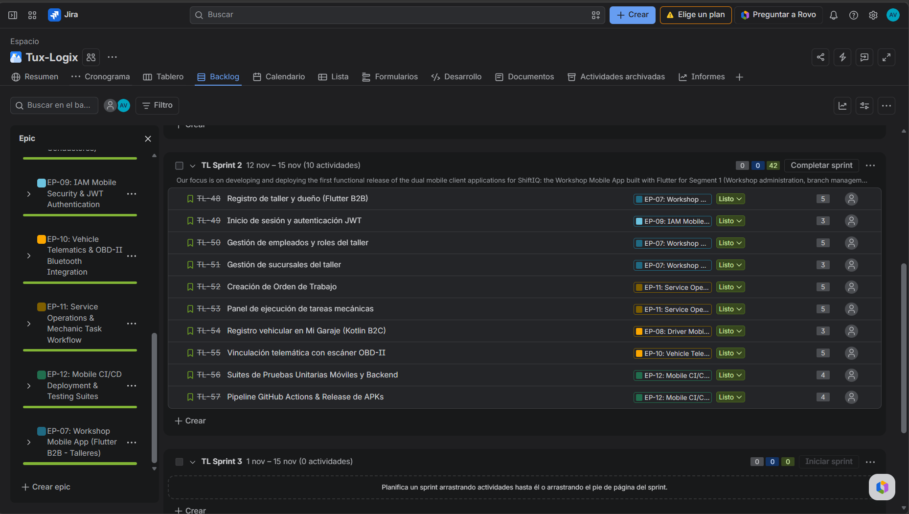

  <h5 style="margin-bottom: 0.5em;">Evidencia 2: Tablero Activo del Sprint 2 en Jira Software (Sprint Board en Columna Done)</h5>
  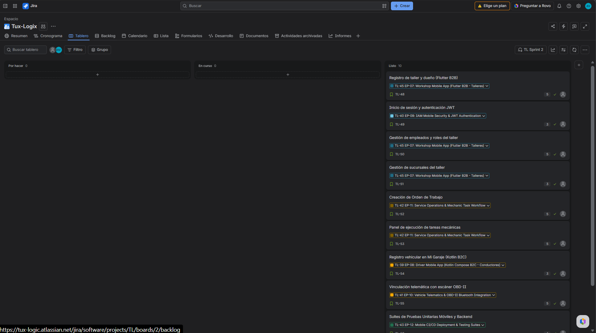

URL del tablero en Jira Software: [https://tux-logic.atlassian.net/jira/software/projects/TL/boards/2](https://tux-logic.atlassian.net/jira/software/projects/TL/boards/2)

  <table style="margin: auto; width: 100%; border-collapse: collapse; text-align: left; font-size: 12px; border: 1px solid #ddd;">
    <thead>
      <tr style="background-color: #e0e0e0; font-weight: bold;">
        <th style="padding: 8px; text-align: center; border: 1px solid #ddd;">Sprint #</th>
        <th colspan="7" style="padding: 8px; text-align: left; border: 1px solid #ddd;">2</th>
      </tr>
      <tr style="background-color: #f2f2f2;">
        <th colspan="2" style="text-align: center; border: 1px solid #ddd; padding: 8px;">User Story</th>
        <th colspan="6" style="text-align: center; border: 1px solid #ddd; padding: 8px;">Work-Item / Task</th>
      </tr>
      <tr style="background-color: #fafafa; text-align: center;">
        <th style="border: 1px solid #ddd; padding: 5px; width: 6%;">Id</th>
        <th style="border: 1px solid #ddd; padding: 5px; width: 16%;">Title</th>
        <th style="border: 1px solid #ddd; padding: 5px; width: 6%;">Id</th>
        <th style="border: 1px solid #ddd; padding: 5px; width: 16%;">Title</th>
        <th style="border: 1px solid #ddd; padding: 5px; width: 28%;">Description</th>
        <th style="border: 1px solid #ddd; padding: 5px; width: 8%;">Estimation (h)</th>
        <th style="border: 1px solid #ddd; padding: 5px; width: 12%;">Assigned To</th>
        <th style="border: 1px solid #ddd; padding: 5px; width: 8%;">Status</th>
      </tr>
    </thead>
    <tbody>
      <tr>
        <td rowspan="2" style="border: 1px solid #ddd; padding: 6px; vertical-align: middle; text-align: center; font-weight: bold;">US001</td>
        <td rowspan="2" style="border: 1px solid #ddd; padding: 6px; vertical-align: middle;">Registro de taller y dueño (Flutter B2B)</td>
        <td style="border: 1px solid #ddd; padding: 6px; text-align: center;">WI-21</td>
        <td style="border: 1px solid #ddd; padding: 6px;">Vistas Registro Flutter</td>
        <td style="border: 1px solid #ddd; padding: 6px;"><i>Formularios asistidos en Flutter para registro de taller, RUC y datos del titular.</i></td>
        <td style="border: 1px solid #ddd; padding: 6px; text-align: center;">6</td>
        <td style="border: 1px solid #ddd; padding: 6px;">Mallqui, Dhilsen / Vidal, Jareth</td>
        <td style="border: 1px solid #ddd; padding: 6px; text-align: center; font-weight: bold; color: #2aac2a;">Done</td>
      </tr>
      <tr>
        <td style="border: 1px solid #ddd; padding: 6px; text-align: center;">WI-22</td>
        <td style="border: 1px solid #ddd; padding: 6px;">Integración SignUp API</td>
        <td style="border: 1px solid #ddd; padding: 6px;"><i>Conexión HTTP Retrofit / Dio con <code>/api/v1/auth/sign-up</code> para validación de RUC.</i></td>
        <td style="border: 1px solid #ddd; padding: 6px; text-align: center;">5</td>
        <td style="border: 1px solid #ddd; padding: 6px;">Mallqui, Dhilsen / Machacca, Aldo</td>
        <td style="border: 1px solid #ddd; padding: 6px; text-align: center; font-weight: bold; color: #2aac2a;">Done</td>
      </tr>
      <tr>
        <td rowspan="2" style="border: 1px solid #ddd; padding: 6px; vertical-align: middle; text-align: center; font-weight: bold;">US002</td>
        <td rowspan="2" style="border: 1px solid #ddd; padding: 6px; vertical-align: middle;">Inicio de sesión y autenticación JWT</td>
        <td style="border: 1px solid #ddd; padding: 6px; text-align: center;">WI-23</td>
        <td style="border: 1px solid #ddd; padding: 6px;">Pantallas Login Flutter y Kotlin</td>
        <td style="border: 1px solid #ddd; padding: 6px;"><i>Maquetación de vistas de acceso para talleres (Flutter) y conductores (Kotlin Compose).</i></td>
        <td style="border: 1px solid #ddd; padding: 6px; text-align: center;">4</td>
        <td style="border: 1px solid #ddd; padding: 6px;">Mallqui, Dhilsen / Mamani, Alan</td>
        <td style="border: 1px solid #ddd; padding: 6px; text-align: center; font-weight: bold; color: #2aac2a;">Done</td>
      </tr>
      <tr>
        <td style="border: 1px solid #ddd; padding: 6px; text-align: center;">WI-24</td>
        <td style="border: 1px solid #ddd; padding: 6px;">Storage Seguro de Token JWT</td>
        <td style="border: 1px solid #ddd; padding: 6px;"><i>Almacenamiento cifrado (Flutter Secure Storage / EncryptedSharedPreferences) e Interceptor Bearer.</i></td>
        <td style="border: 1px solid #ddd; padding: 6px; text-align: center;">5</td>
        <td style="border: 1px solid #ddd; padding: 6px;">Mamani, Alan / Machacca, Aldo</td>
        <td style="border: 1px solid #ddd; padding: 6px; text-align: center; font-weight: bold; color: #2aac2a;">Done</td>
      </tr>
      <tr>
        <td rowspan="2" style="border: 1px solid #ddd; padding: 6px; vertical-align: middle; text-align: center; font-weight: bold;">US005</td>
        <td rowspan="2" style="border: 1px solid #ddd; padding: 6px; vertical-align: middle;">Gestión de empleados y roles del taller (Flutter)</td>
        <td style="border: 1px solid #ddd; padding: 6px; text-align: center;">WI-25</td>
        <td style="border: 1px solid #ddd; padding: 6px;">Módulo Staff y Mecánicos</td>
        <td style="border: 1px solid #ddd; padding: 6px;"><i>Listado de colaboradores del taller con asignación de roles operativos en Flutter.</i></td>
        <td style="border: 1px solid #ddd; padding: 6px; text-align: center;">5</td>
        <td style="border: 1px solid #ddd; padding: 6px;">Vidal, Jareth / Mallqui, Dhilsen</td>
        <td style="border: 1px solid #ddd; padding: 6px; text-align: center; font-weight: bold; color: #2aac2a;">Done</td>
      </tr>
      <tr>
        <td style="border: 1px solid #ddd; padding: 6px; text-align: center;">WI-26</td>
        <td style="border: 1px solid #ddd; padding: 6px;">Control de Acceso RBAC</td>
        <td style="border: 1px solid #ddd; padding: 6px;"><i>Filtrado de vistas y privilegios en Flutter según el rol autenticado (Admin o Mecánico).</i></td>
        <td style="border: 1px solid #ddd; padding: 6px; text-align: center;">4</td>
        <td style="border: 1px solid #ddd; padding: 6px;">Machacca, Aldo</td>
        <td style="border: 1px solid #ddd; padding: 6px; text-align: center; font-weight: bold; color: #2aac2a;">Done</td>
      </tr>
      <tr>
        <td rowspan="2" style="border: 1px solid #ddd; padding: 6px; vertical-align: middle; text-align: center; font-weight: bold;">US006</td>
        <td rowspan="2" style="border: 1px solid #ddd; padding: 6px; vertical-align: middle;">Gestión de sucursales operativas (Flutter)</td>
        <td style="border: 1px solid #ddd; padding: 6px; text-align: center;">WI-27</td>
        <td style="border: 1px solid #ddd; padding: 6px;">CRUD de Sucursales en Flutter</td>
        <td style="border: 1px solid #ddd; padding: 6px;"><i>Interfaz para creación y consulta de sedes físicas, dirección y capacidad técnica.</i></td>
        <td style="border: 1px solid #ddd; padding: 6px; text-align: center;">4</td>
        <td style="border: 1px solid #ddd; padding: 6px;">Mallqui, Dhilsen</td>
        <td style="border: 1px solid #ddd; padding: 6px; text-align: center; font-weight: bold; color: #2aac2a;">Done</td>
      </tr>
      <tr>
        <td style="border: 1px solid #ddd; padding: 6px; text-align: center;">WI-28</td>
        <td style="border: 1px solid #ddd; padding: 6px;">Sincronización con Backend Core</td>
        <td style="border: 1px solid #ddd; padding: 6px;"><i>Conexión con <code>/api/v1/workshops/{id}/branches</code> para persistencia en PostgreSQL.</i></td>
        <td style="border: 1px solid #ddd; padding: 6px; text-align: center;">4</td>
        <td style="border: 1px solid #ddd; padding: 6px;">Machacca, Aldo</td>
        <td style="border: 1px solid #ddd; padding: 6px; text-align: center; font-weight: bold; color: #2aac2a;">Done</td>
      </tr>
      <tr>
        <td rowspan="2" style="border: 1px solid #ddd; padding: 6px; vertical-align: middle; text-align: center; font-weight: bold;">US012</td>
        <td rowspan="2" style="border: 1px solid #ddd; padding: 6px; vertical-align: middle;">Creación de Orden de Trabajo (Flutter)</td>
        <td style="border: 1px solid #ddd; padding: 6px; text-align: center;">WI-29</td>
        <td style="border: 1px solid #ddd; padding: 6px;">Formulario OT en Flutter</td>
        <td style="border: 1px solid #ddd; padding: 6px;"><i>Apertura de orden con selección de vehículo, cliente, síntoma y kilometraje.</i></td>
        <td style="border: 1px solid #ddd; padding: 6px; text-align: center;">5</td>
        <td style="border: 1px solid #ddd; padding: 6px;">Vidal, Jareth / Mallqui, Dhilsen</td>
        <td style="border: 1px solid #ddd; padding: 6px; text-align: center; font-weight: bold; color: #2aac2a;">Done</td>
      </tr>
      <tr>
        <td style="border: 1px solid #ddd; padding: 6px; text-align: center;">WI-30</td>
        <td style="border: 1px solid #ddd; padding: 6px;">Apertura OT en Backend</td>
        <td style="border: 1px solid #ddd; padding: 6px;"><i>Consumir POST <code>/api/v1/work-orders</code> para registrar la OT en estado OPEN.</i></td>
        <td style="border: 1px solid #ddd; padding: 6px; text-align: center;">4</td>
        <td style="border: 1px solid #ddd; padding: 6px;">Machacca, Aldo</td>
        <td style="border: 1px solid #ddd; padding: 6px; text-align: center; font-weight: bold; color: #2aac2a;">Done</td>
      </tr>
      <tr>
        <td rowspan="2" style="border: 1px solid #ddd; padding: 6px; vertical-align: middle; text-align: center; font-weight: bold;">US014</td>
        <td rowspan="2" style="border: 1px solid #ddd; padding: 6px; vertical-align: middle;">Gestión y finalización de tareas técnicas (Flutter)</td>
        <td style="border: 1px solid #ddd; padding: 6px; text-align: center;">WI-31</td>
        <td style="border: 1px solid #ddd; padding: 6px;">Panel del Mecánico en Flutter</td>
        <td style="border: 1px solid #ddd; padding: 6px;"><i>Espacio interactivo de tareas con acciones táctiles para Iniciar, Pausar y Completar.</i></td>
        <td style="border: 1px solid #ddd; padding: 6px; text-align: center;">6</td>
        <td style="border: 1px solid #ddd; padding: 6px;">Mallqui, Dhilsen / Vidal, Jareth</td>
        <td style="border: 1px solid #ddd; padding: 6px; text-align: center; font-weight: bold; color: #2aac2a;">Done</td>
      </tr>
      <tr>
        <td style="border: 1px solid #ddd; padding: 6px; text-align: center;">WI-32</td>
        <td style="border: 1px solid #ddd; padding: 6px;">Sincronización PATCH de Tareas</td>
        <td style="border: 1px solid #ddd; padding: 6px;"><i>Consumo de <code>/api/v1/work-orders/{id}/tasks/{taskId}</code> con actualización en tiempo real.</i></td>
        <td style="border: 1px solid #ddd; padding: 6px; text-align: center;">4</td>
        <td style="border: 1px solid #ddd; padding: 6px;">Machacca, Aldo</td>
        <td style="border: 1px solid #ddd; padding: 6px; text-align: center; font-weight: bold; color: #2aac2a;">Done</td>
      </tr>
      <tr>
        <td rowspan="2" style="border: 1px solid #ddd; padding: 6px; vertical-align: middle; text-align: center; font-weight: bold;">US017</td>
        <td rowspan="2" style="border: 1px solid #ddd; padding: 6px; vertical-align: middle;">Registro de vehículo en Mi Garaje (Kotlin B2C)</td>
        <td style="border: 1px solid #ddd; padding: 6px; text-align: center;">WI-33</td>
        <td style="border: 1px solid #ddd; padding: 6px;">Pantallas Mi Garaje en Kotlin</td>
        <td style="border: 1px solid #ddd; padding: 6px;"><i>Vistas en Jetpack Compose para registro vehicular (marca, modelo, año, placa, VIN).</i></td>
        <td style="border: 1px solid #ddd; padding: 6px; text-align: center;">4</td>
        <td style="border: 1px solid #ddd; padding: 6px;">Mamani, Alan</td>
        <td style="border: 1px solid #ddd; padding: 6px; text-align: center; font-weight: bold; color: #2aac2a;">Done</td>
      </tr>
      <tr>
        <td style="border: 1px solid #ddd; padding: 6px; text-align: center;">WI-34</td>
        <td style="border: 1px solid #ddd; padding: 6px;">Consumo de Endpoints de Vehículos</td>
        <td style="border: 1px solid #ddd; padding: 6px;"><i>Integración con <code>/api/v1/vehicles</code> mediante Retrofit y repositorio Android.</i></td>
        <td style="border: 1px solid #ddd; padding: 6px; text-align: center;">4</td>
        <td style="border: 1px solid #ddd; padding: 6px;">Mamani, Alan / Machacca, Aldo</td>
        <td style="border: 1px solid #ddd; padding: 6px; text-align: center; font-weight: bold; color: #2aac2a;">Done</td>
      </tr>
      <tr>
        <td rowspan="2" style="border: 1px solid #ddd; padding: 6px; vertical-align: middle; text-align: center; font-weight: bold;">US018</td>
        <td rowspan="2" style="border: 1px solid #ddd; padding: 6px; vertical-align: middle;">Vinculación telemática OBD-II (Kotlin B2C)</td>
        <td style="border: 1px solid #ddd; padding: 6px; text-align: center;">WI-35</td>
        <td style="border: 1px solid #ddd; padding: 6px;">Emparejamiento Bluetooth OBD-II</td>
        <td style="border: 1px solid #ddd; padding: 6px;"><i>Flujo en Kotlin para escaneo y emparejamiento con el hardware OBD2 mediante dirección MAC.</i></td>
        <td style="border: 1px solid #ddd; padding: 6px; text-align: center;">5</td>
        <td style="border: 1px solid #ddd; padding: 6px;">Mamani, Alan</td>
        <td style="border: 1px solid #ddd; padding: 6px; text-align: center; font-weight: bold; color: #2aac2a;">Done</td>
      </tr>
      <tr>
        <td style="border: 1px solid #ddd; padding: 6px; text-align: center;">WI-36</td>
        <td style="border: 1px solid #ddd; padding: 6px;">Persistencia IoT en Backend</td>
        <td style="border: 1px solid #ddd; padding: 6px;"><i>Consumo de <code>/api/v1/vehicles/{id}/obd2/bind</code> para asociar el dispositivo al vehículo.</i></td>
        <td style="border: 1px solid #ddd; padding: 6px; text-align: center;">4</td>
        <td style="border: 1px solid #ddd; padding: 6px;">Mamani, Alan / Machacca, Aldo</td>
        <td style="border: 1px solid #ddd; padding: 6px; text-align: center; font-weight: bold; color: #2aac2a;">Done</td>
      </tr>
    </tbody>
  </table>

---

### 4.2.2.4. Development Evidence for Sprint Review

Durante el Sprint 2, el equipo TuxLogic gestionó en paralelo los repositorios móviles de ambos segmentos y la plataforma backend:

- **Repositorio Taller B2B:** <code>tux-logic/shiftiq-mobile-app-flutter</code> (Flutter / Dart)
- **Repositorio Conductor B2C:** <code>tux-logic/shiftiq-mobile-app</code> (Android Nativo / Kotlin / Jetpack Compose)
- **Repositorio Backend API:** <code>tux-logic/shiftiq-platform</code> (Spring Boot 3.5.5 / PostgreSQL 18)

A continuación, se presenta la selección de commits representativos que evidencian los hitos de desarrollo logrados en esta iteración:

<table style="width: 100%; border-collapse: collapse; text-align: justify; font-size: 12px;">
  <thead>
    <tr style="background-color: #f2f2f2;">
      <th style="border: 1px solid #ddd; padding: 8px;">Repository</th>
      <th style="border: 1px solid #ddd; padding: 8px;">Branch</th>
      <th style="border: 1px solid #ddd; padding: 8px;">Commit Id</th>
      <th style="border: 1px solid #ddd; padding: 8px;">Commit Message</th>
      <th style="border: 1px solid #ddd; padding: 8px;">Commit Message Body</th>
      <th style="border: 1px solid #ddd; padding: 8px;">Committed on</th>
    </tr>
  </thead>
  <tbody>
    <tr>
      <td style="border: 1px solid #ddd; padding: 6px;"><code>shiftiq_mobile_app_flutter</code></td>
      <td style="border: 1px solid #ddd; padding: 6px;"><code>feature/workshop-architecture</code></td>
      <td style="border: 1px solid #ddd; padding: 6px;"><code>a12c840</code></td>
      <td style="border: 1px solid #ddd; padding: 6px;">feat(core):</td>
      <td style="border: 1px solid #ddd; padding: 6px;">setup Flutter clean architecture, Provider state management and Dio client</td>
      <td style="border: 1px solid #ddd; padding: 6px;">2026-10-08</td>
    </tr>
    <tr>
      <td style="border: 1px solid #ddd; padding: 6px;"><code>shiftiq_mobile_app_flutter</code></td>
      <td style="border: 1px solid #ddd; padding: 6px;"><code>feature/workshop-work-orders</code></td>
      <td style="border: 1px solid #ddd; padding: 6px;"><code>b34d911</code></td>
      <td style="border: 1px solid #ddd; padding: 6px;">feat(operations):</td>
      <td style="border: 1px solid #ddd; padding: 6px;">implement work orders dashboard, task progress controls and mechanic assignment</td>
      <td style="border: 1px solid #ddd; padding: 6px;">2026-10-15</td>
    </tr>
    <tr>
      <td style="border: 1px solid #ddd; padding: 6px;"><code>shiftiq-mobile-app</code></td>
      <td style="border: 1px solid #ddd; padding: 6px;"><code>feature/driver-architecture-compose</code></td>
      <td style="border: 1px solid #ddd; padding: 6px;"><code>c56e023</code></td>
      <td style="border: 1px solid #ddd; padding: 6px;">feat(core):</td>
      <td style="border: 1px solid #ddd; padding: 6px;">setup Kotlin clean architecture layers, Jetpack Compose UI and Hilt DI</td>
      <td style="border: 1px solid #ddd; padding: 6px;">2026-10-09</td>
    </tr>
    <tr>
      <td style="border: 1px solid #ddd; padding: 6px;"><code>shiftiq-mobile-app</code></td>
      <td style="border: 1px solid #ddd; padding: 6px;"><code>feature/driver-obd2-pairing</code></td>
      <td style="border: 1px solid #ddd; padding: 6px;"><code>d78f145</code></td>
      <td style="border: 1px solid #ddd; padding: 6px;">feat(iot):</td>
      <td style="border: 1px solid #ddd; padding: 6px;">implement garage screen, Bluetooth OBD-II device pairing and DTC telemetry alerts</td>
      <td style="border: 1px solid #ddd; padding: 6px;">2026-10-22</td>
    </tr>
    <tr>
      <td style="border: 1px solid #ddd; padding: 6px;"><code>shiftiq-platform</code></td>
      <td style="border: 1px solid #ddd; padding: 6px;"><code>feature/mobile-api-cors-hardening</code></td>
      <td style="border: 1px solid #ddd; padding: 6px;"><code>f83c114</code></td>
      <td style="border: 1px solid #ddd; padding: 6px;">fix(security):</td>
      <td style="border: 1px solid #ddd; padding: 6px;">harden CORS configuration and add mobile device header logging in Spring Security</td>
      <td style="border: 1px solid #ddd; padding: 6px;">2026-10-28</td>
    </tr>
  </tbody>
</table>

---

### 4.2.2.5. Testing Suite Evidence for Sprint Review

Para certificar la estabilidad de ambas soluciones móviles frente a la plataforma backend, se ejecutaron baterías de pruebas automatizadas:

1. **Flutter Unit & Widget Tests (Workshop App):** Validación de lógica en ViewModels/Providers, cálculo de presupuestos de órdenes de trabajo y renderizado de componentes interactivos con el comando `flutter test`.
2. **Kotlin Unit Tests & Robolectric (Driver App):** Verificación de casos de uso de registro vehicular, validaciones de código VIN, lógica de conexión telemática Bluetooth y almacenamiento cifrado de credenciales JWT.
3. **Backend Regression Tests (Spring Boot):** Batería de pruebas unitarias y de integración con JUnit 5 y Mockito para confirmar la resiliencia de los endpoints ante solicitudes concurrentes de ambas aplicaciones móviles.

  <h5 style="margin-bottom: 0.5em;">Evidencia: Ejecución Exitosa de las Suites de Pruebas Móviles (Flutter & Kotlin) y Backend</h5>
  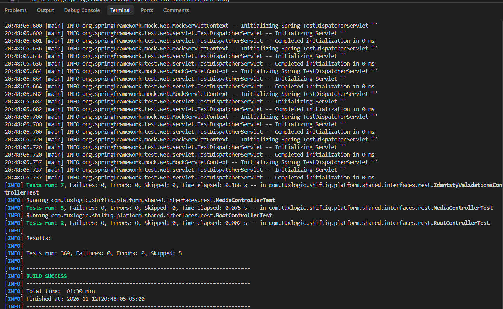

---

### 4.2.2.6. Execution Evidence for Sprint Review

En esta sección se presenta la evidencia audiovisual y funcional de la ejecución del producto correspondiente al Sprint 2. El resultado comprende ambas aplicaciones móviles de ShiftIQ operando de forma independiente sobre emuladores y dispositivos físicos Android, conectadas en tiempo real a los microservicios RESTful en Render Cloud:

1. **ShiftIQ Driver App (Segmento 2 - Conductores B2C en Kotlin Nativo / Jetpack Compose):** Demostración del flujo de telemetría en tiempo real, escaneo OBD-II con traducción didáctica de fallas DTC en lenguaje natural, catálogo de talleres afiliados y agendamiento interactivo de citas.
2. **ShiftIQ Workshop App (Segmento 1 - Talleres B2B en Flutter / Dart):** Demostración del panel de administración del taller, gestión de sucursales, apertura de órdenes de trabajo y espacio de ejecución de tareas mecánicas en tiempo real.

A continuación, se disponen los enlaces a las grabaciones oficiales de navegación y ejecución de ambas aplicaciones, acompañados de sus respectivas capturas de reproducción:

- **Video 1: Navegación del Producto en Kotlin (ShiftIQ Driver App - Conductor B2C):**  
  [upc-pre-202620-1acc0238-13981-Tux-Logic-productnavigation-av2.mp4](https://upcedupe-my.sharepoint.com/:v:/g/personal/u202224130_upc_edu_pe/IQClS-5I-l3CRqgxRJyKbJIHAXBujJv0SyJuIAusNBzmJ5g?nav=eyJyZWZlcnJhbEluZm8iOnsicmVmZXJyYWxBcHAiOiJPbmVEcml2ZUZvckJ1c2luZXNzIiwicmVmZXJyYWxBcHBQbGF0Zm9ybSI6IldlYiIsInJlZmVycmFsTW9kZSI6InZpZXciLCJyZWZlcnJhbFZpZXciOiJNeUZpbGVzTGlua0NvcHkifX0&e=UklbiF) *(Grabado por Diego Ramos)*

  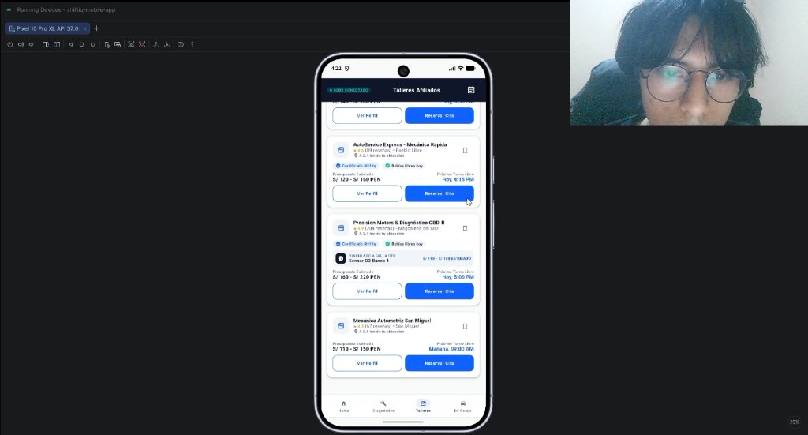

- **Video 2: Navegación del Producto en Flutter (ShiftIQ Workshop App - Taller B2B):**  
  [upc-pre-202620-1acc0238-13981-Tux-Logic-workshop-navigation-av2.mp4](https://drive.google.com/file/d/1TuoNJeeY1T-oAVaM7BXqTjasaG_TjvEG/view?usp=sharing) *(Grabado por Aldo Macchaca)*

  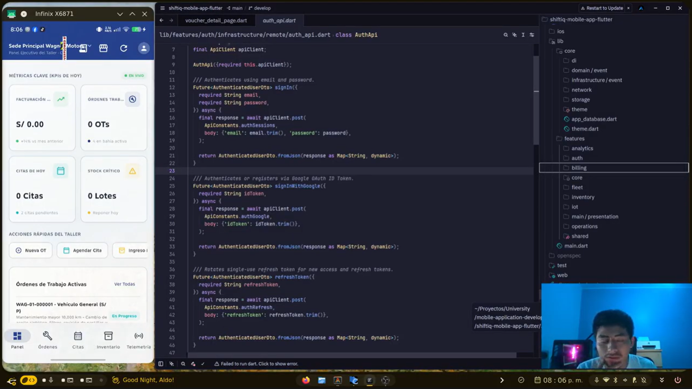

  <h5>Evidencia 1: ShiftIQ Workshop App (Flutter B2B) - Dashboard Operativo, Sucursales y Órdenes de Trabajo</h5>
  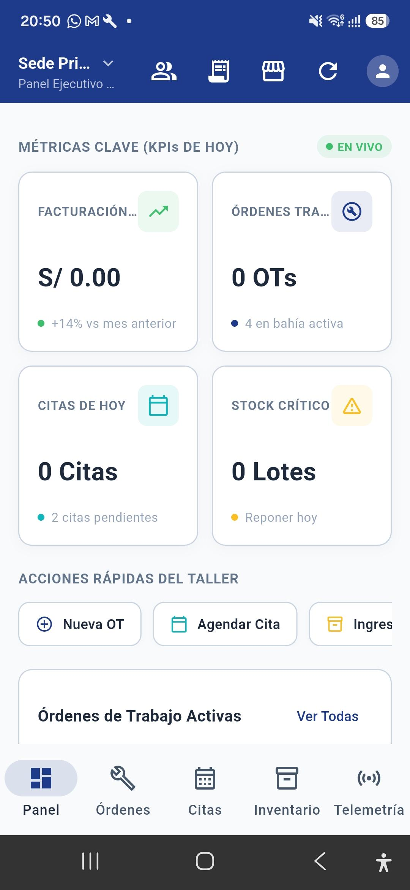

  <h5>Evidencia 2: ShiftIQ Driver App (Kotlin B2C) - Mi Garaje, Telemetría DTC y Agendamiento de Citas</h5>
  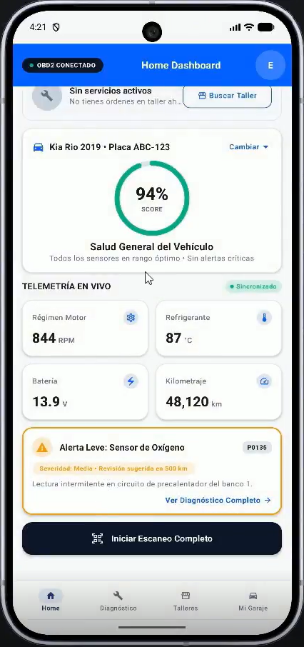

<b>Repositorios Oficiales de Código Fuente Móvil:</b>

- **Repositorio Driver App (Kotlin / Compose):** [https://github.com/tux-logic/shiftiq-mobile-app](https://github.com/tux-logic/shiftiq-mobile-app)
- **Repositorio Workshop App (Flutter / Dart):** [https://github.com/tux-logic/shiftiq-mobile-app-flutter](https://github.com/tux-logic/shiftiq-mobile-app-flutter)

---

### 4.2.2.7. Services Documentation Evidence for Sprint Review

Durante el Sprint 2 se consolidó el catálogo de servicios RESTful documentados mediante OpenAPI 3.0 / Swagger UI, verificando la compatibilidad de los contratos de datos consumidos por la app en Flutter y la app en Kotlin:

<table style="width: 100%; border-collapse: collapse; text-align: left; font-size: 12px; margin: auto;">
  <thead>
    <tr style="background-color: #f2f2f2;">
      <th style="border: 1px solid #ddd; padding: 6px; text-align: center;">Endpoint</th>
      <th style="border: 1px solid #ddd; padding: 6px; text-align: center;">HTTP Method</th>
      <th style="border: 1px solid #ddd; padding: 6px; text-align: center;">Bounded Context</th>
      <th style="border: 1px solid #ddd; padding: 6px;">Cliente Móvil Consumidor</th>
      <th style="border: 1px solid #ddd; padding: 6px;">Propósito Funcional</th>
    </tr>
  </thead>
  <tbody>
    <tr>
      <td style="border: 1px solid #ddd; padding: 6px; text-align: center;"><code>/api/v1/auth/sign-in</code></td>
      <td style="border: 1px solid #ddd; padding: 6px; text-align: center;"><strong>POST</strong></td>
      <td style="border: 1px solid #ddd; padding: 6px; text-align: center;">IAM</td>
      <td style="border: 1px solid #ddd; padding: 6px;">Flutter (B2B) & Kotlin (B2C)</td>
      <td style="border: 1px solid #ddd; padding: 6px;">Autenticación con emisión de JWT Bearer Token y roles de usuario.</td>
    </tr>
    <tr>
      <td style="border: 1px solid #ddd; padding: 6px; text-align: center;"><code>/api/v1/workshops/{id}/branches</code></td>
      <td style="border: 1px solid #ddd; padding: 6px; text-align: center;"><strong>GET / POST</strong></td>
      <td style="border: 1px solid #ddd; padding: 6px; text-align: center;">Workshop Core</td>
      <td style="border: 1px solid #ddd; padding: 6px;">Flutter App (Taller B2B)</td>
      <td style="border: 1px solid #ddd; padding: 6px;">Gestión de sedes físicas y capacidad de bahías de atención del taller.</td>
    </tr>
    <tr>
      <td style="border: 1px solid #ddd; padding: 6px; text-align: center;"><code>/api/v1/work-orders/{id}/tasks/{taskId}</code></td>
      <td style="border: 1px solid #ddd; padding: 6px; text-align: center;"><strong>PATCH</strong></td>
      <td style="border: 1px solid #ddd; padding: 6px; text-align: center;">Service Operations</td>
      <td style="border: 1px solid #ddd; padding: 6px;">Flutter App (Taller B2B)</td>
      <td style="border: 1px solid #ddd; padding: 6px;">Actualización del progreso de tareas técnicas en el espacio del mecánico.</td>
    </tr>
    <tr>
      <td style="border: 1px solid #ddd; padding: 6px; text-align: center;"><code>/api/v1/vehicles</code></td>
      <td style="border: 1px solid #ddd; padding: 6px; text-align: center;"><strong>POST / GET</strong></td>
      <td style="border: 1px solid #ddd; padding: 6px; text-align: center;">Vehicle Intelligence</td>
      <td style="border: 1px solid #ddd; padding: 6px;">Kotlin App (Conductor B2C)</td>
      <td style="border: 1px solid #ddd; padding: 6px;">Registro y consulta de unidades vehiculares en el módulo "Mi Garaje".</td>
    </tr>
    <tr>
      <td style="border: 1px solid #ddd; padding: 6px; text-align: center;"><code>/api/v1/vehicles/{id}/obd2/bind</code></td>
      <td style="border: 1px solid #ddd; padding: 6px; text-align: center;"><strong>POST</strong></td>
      <td style="border: 1px solid #ddd; padding: 6px; text-align: center;">IoT & Diagnostics</td>
      <td style="border: 1px solid #ddd; padding: 6px;">Kotlin App (Conductor B2C)</td>
      <td style="border: 1px solid #ddd; padding: 6px;">Vinculación telemática del escáner OBD-II por dirección MAC y protocolo ELM327.</td>
    </tr>
  </tbody>
</table>

  <h5 style="margin-bottom: 0.5em;">Evidencia: Ejecución e Interacción de Endpoints en Swagger UI para Clientes Móviles</h5>
  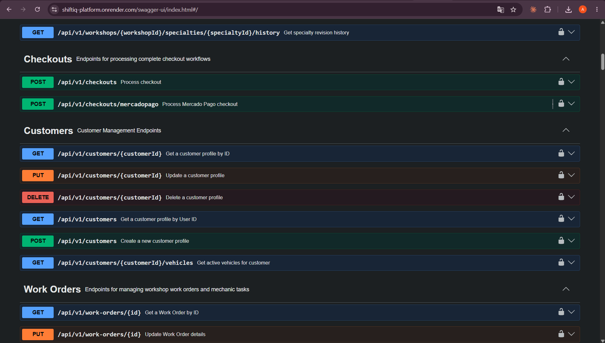

---

### 4.2.2.8. Software Deployment Evidence for Sprint Review

Durante el Sprint 2, el proceso de despliegue abarcó la compilación de releases para ambas aplicaciones móviles y la operación continua del backend:

1. **Despliegue de ShiftIQ Workshop App (Flutter B2B):**
   - **Repositorio:** <code>tux-logic/shiftiq-mobile-app-flutter</code>
   - **Plataforma de Distribución en la Nube:** **Firebase App Distribution** (Google Cloud Platform) para instalación directa de betas y releases en Android.
   - **Enlace Público Oficial de Descarga:** [https://appdistribution.firebase.dev/i/40720f8e62ef7ca4](https://appdistribution.firebase.dev/i/40720f8e62ef7ca4)
   - **Pipeline CI/CD:** GitHub Actions con Flutter Build APK release automatizado.
   - **Artefacto:** <code>shiftiq-workshop-release-v1.0.0.apk</code> distribuido mediante Firebase App Distribution.

2. **Despliegue de ShiftIQ Driver App (Kotlin B2C):**
   - **Repositorio:** <code>tux-logic/shiftiq-mobile-app</code>
   - **Pipeline CI/CD:** GitHub Actions con Android Gradle Build y firma de APK.
   - **GitHub Release:** [https://github.com/tux-logic/shiftiq-mobile-app/releases/tag/v1.0.0](https://github.com/tux-logic/shiftiq-mobile-app/releases/tag/v1.0.0)
   - **Artefacto:** <code>shiftiq-driver-release-v1.0.0.apk</code> listo para instalación en smartphones Android.

3. **Backend REST API en Producción (Render Cloud):**
   - **URL Pública:** [https://shiftiq-platform.onrender.com](https://shiftiq-platform.onrender.com)
   - **Swagger UI en Vivo:** [https://shiftiq-platform.onrender.com/swagger-ui.html](https://shiftiq-platform.onrender.com/swagger-ui.html)

  <h5>Evidencia 1: Workflow de CI/CD en GitHub Actions para Compilación y Firma de APKs Móviles</h5>
  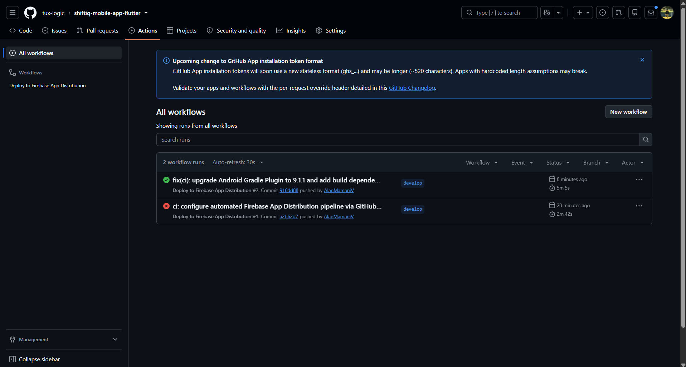

  <h5>Evidencia 2: Despliegue y Distribución de ShiftIQ Workshop App (Flutter) en Firebase App Distribution</h5>
  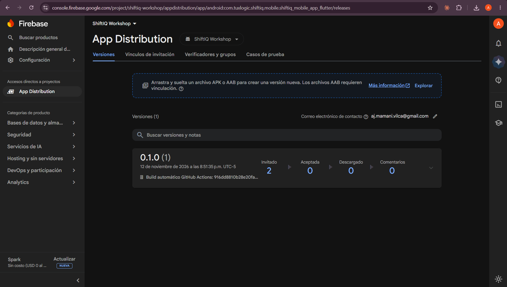

  <h5>Evidencia 3: GitHub Release con Paquete APK de Kotlin Disponible para Descarga</h5>
  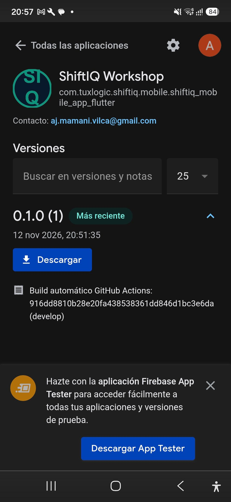

---

### 4.2.2.9. Team Collaboration Insights during Sprint 2

Durante el Sprint 2, el equipo TuxLogic mantuvo una rigurosa coordinación entre el desarrollo híbrido en Flutter, nativo en Kotlin y backend en Spring Boot. La integración de código se efectuó mediante ramas de características (<i>feature branches</i>), Pull Requests obligatorios con revisión de pares y la adopción estricta de la convención <i>Conventional Commits</i>.

A continuación, se presentan los analíticos extraídos de GitHub (Insights) que constatan el trabajo colaborativo de los 5 integrantes durante el Sprint 2:

  <h5>Evidencia 1: Gráfico de Contribuciones por Miembro del Equipo durante el Sprint 2</h5>
  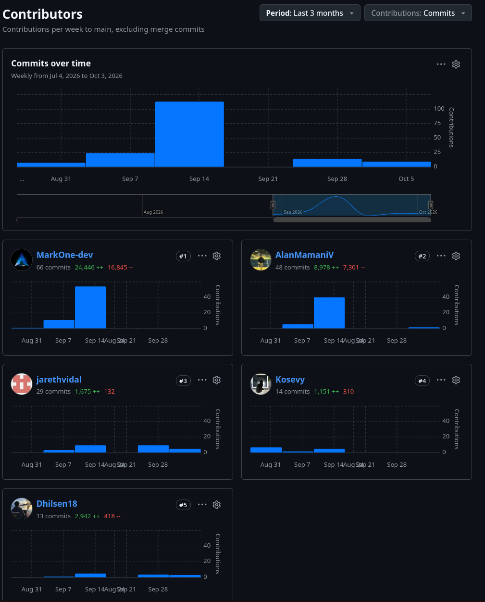

  <h5>Evidencia 2: Resumen de Actividad de Repositorios Móviles (GitHub Pulse)</h5>
  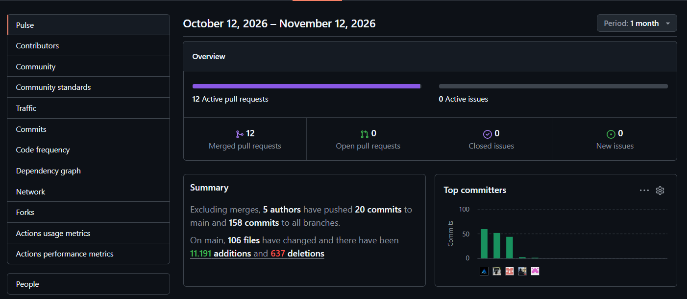

  <h5>Evidencia 3: Gestión Colaborativa mediante Pull Requests Fusionados</h5>
  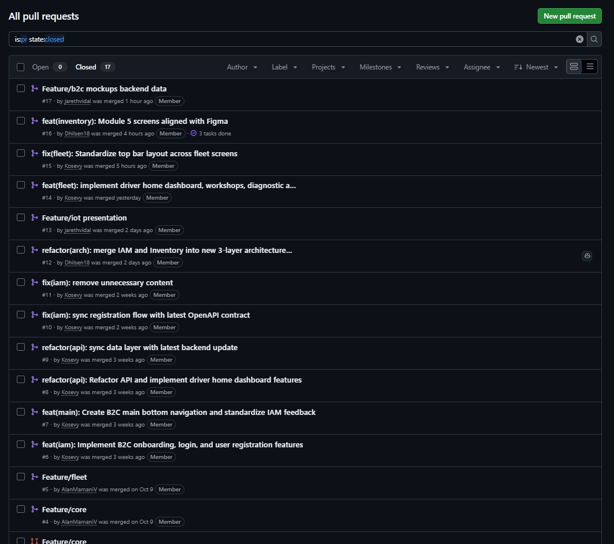

Los registros confirman la distribución equilibrada de tareas entre las dos aplicaciones móviles clientes, garantizando la evolución consistente y robusta del ecosistema bilateral <b>ShiftIQ</b>.

