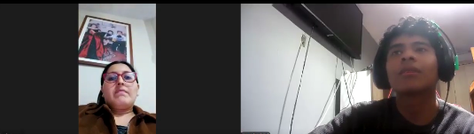

# 4.3. Validation Interviews

## 4.3.2. Registro de Entrevistas

**Segmento Objetivo 2: Conductores de Vehículos Particulares en Lima (B2C)**

<table>
<thead>
  <tr>
    <th colspan="2">Entrevista 1: Usuario de Vehículo Particular y Hábitos de Mantenimiento </th>
  </tr>
</thead>
<tbody>
  <tr>
    <td>Nombre</td>
    <td>Fatima</td>
  </tr>
  <tr>
    <td>Apellidos</td>
    <td>Trujillo Mendoza</td>
  </tr>
  <tr>
    <td>Edad</td>
    <td>36 años</td>
  </tr>
  <tr>
    <td>Distrito</td>
    <td>San Miguel, Lima</td>
  </tr>
  <tr>
    <td>Aplicaciones Usadas</td>
    <td>Google Maps, WhatsApp, Yape, banca móvil</td>
  </tr>
  <tr>
    <td>Tecnologías</td>
    <td>Smartphone iPhone 12 (iOS)</td>
  </tr>
  <tr>
    <td>Browsers</td>
    <td>Safari</td>
  </tr>
  <tr>
    <td>Entrevistador</td>
    <td>Jareth Vidal</td>
  </tr>
  <tr>
    <td>Evidencia</td>
    <td>
      
<b>Imagen 3:</b> Captura de pantalla de la entrevista con Fátima Trujillo Mendoza

      
    </td>
  </tr>
  <tr>
  <td>Link</td>
  <td><a href="https://drive.google.com/file/d/1NQ-v7RYPOU6eMQghPgucIBd6jVuR7s7T/view?usp=sharing" target="_blank">Ver entrevista</a></td>
</tr>
  <tr>
    <td>Duración </td>
    <td>05:27</td>
  </tr>
  <tr>
    <td>Resumen</td>
    <td>Durante la sesión de validación, la entrevistada observó el registro de un vehículo y consideró que el proceso era claro, aunque señaló que el VIN requiere más cuidado por sus 17 caracteres. Comprendió mejor la explicación de la falla que el código técnico y sugirió incluir recomendaciones sobre los pasos a seguir. También percibió la navegación como ordenada y rápida; el flujo para elegir taller y fecha le pareció sencillo, aunque consideró importante confirmar claramente si la cita quedó registrada. Indicó que, si tuviera un conector OBD-II, revisaría la aplicación mensualmente y ante una alerta o antes de un viaje. Como mejoras, propuso agregar recordatorios de mantenimiento, estimaciones de costos e historial del vehículo, además de distinguir claramente las lecturas reales de las demostrativas.</td>
  </tr>
</tbody>
</table>