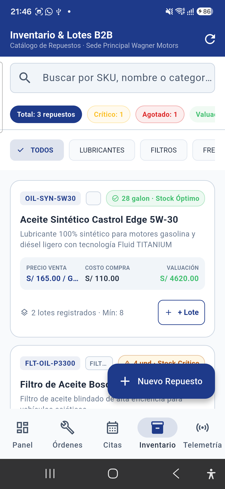
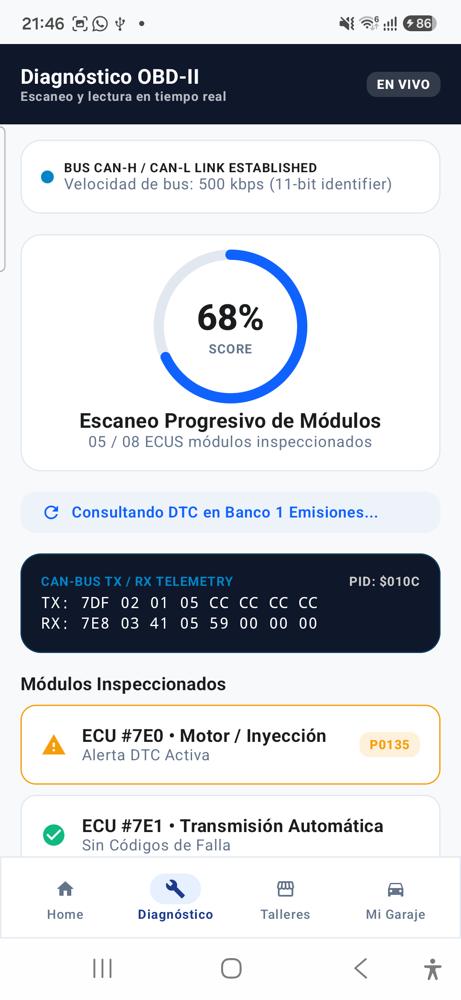

# 4.3. Validation Interviews

## 4.3.3. Evaluaciones según Heurísticas

Para garantizar que las aplicaciones móviles del ecosistema <b>ShiftIQ</b> cumplan con los más altos estándares de usabilidad, accesibilidad y experiencia de usuario antes de su entrega y adopción final, el equipo TuxLogic llevó a cabo una <b>Evaluación Heurística de Usabilidad</b> basada en las <b>10 Heurísticas de Usabilidad de Jakob Nielsen (1994)</b>.

La evaluación se aplicó de manera rigurosa sobre los dos aplicativos clientes implementados en el Sprint 2:

1. **ShiftIQ Workshop App (Segmento 1 - Talleres Automotrices B2B):** Desarrollada en **Flutter / Dart**, enfocada en la gestión operativa de talleres, administración de sucursales, apertura de órdenes de trabajo y espacio de ejecución de tareas mecánicas.
2. **ShiftIQ Driver App (Segmento 2 - Conductores Particulares B2C):** Desarrollada en **Kotlin nativo / Jetpack Compose**, enfocada en el módulo "Mi Garaje", vinculación telemática Bluetooth con escáner OBD-II, traducción didáctica de fallas DTC y catálogo de talleres afiliados.

---

### 4.3.3.1. Metodología de Evaluación y Escala de Severidad de Nielsen

Cada hallazgo o problema de usabilidad identificado por los evaluadores fue clasificado de acuerdo con la escala estándar de severidad de Nielsen (0 a 4), lo que permite priorizar las acciones correctivas de ingeniería:

<table style="width: 100%; border-collapse: collapse; text-align: left; font-size: 12px; margin: auto;">
  <thead>
    <tr style="background-color: #f2f2f2;">
      <th style="border: 1px solid #ddd; padding: 8px; text-align: center; width: 12%;">Nivel</th>
      <th style="border: 1px solid #ddd; padding: 8px; width: 25%;">Severidad</th>
      <th style="border: 1px solid #ddd; padding: 8px;">Definición y Criterio de Impacto</th>
      <th style="border: 1px solid #ddd; padding: 8px; text-align: center; width: 18%;">Acción Requerida</th>
    </tr>
  </thead>
  <tbody>
    <tr>
      <td style="border: 1px solid #ddd; padding: 6px; text-align: center; font-weight: bold;">0</td>
      <td style="border: 1px solid #ddd; padding: 6px; color: #555;">No es un problema</td>
      <td style="border: 1px solid #ddd; padding: 6px;">No afecta la usabilidad ni la finalización de la tarea. Comentario estético menor.</td>
      <td style="border: 1px solid #ddd; padding: 6px; text-align: center;">Ninguna</td>
    </tr>
    <tr>
      <td style="border: 1px solid #ddd; padding: 6px; text-align: center; font-weight: bold; color: #2e7d32;">1</td>
      <td style="border: 1px solid #ddd; padding: 6px; font-weight: bold; color: #2e7d32;">Problema Cosmético</td>
      <td style="border: 1px solid #ddd; padding: 6px;">No entorpece la tarea, pero afecta el acabado visual (espaciados, contraste ligero).</td>
      <td style="border: 1px solid #ddd; padding: 6px; text-align: center;">Baja prioridad</td>
    </tr>
    <tr>
      <td style="border: 1px solid #ddd; padding: 6px; text-align: center; font-weight: bold; color: #f57c00;">2</td>
      <td style="border: 1px solid #ddd; padding: 6px; font-weight: bold; color: #f57c00;">Problema Menor</td>
      <td style="border: 1px solid #ddd; padding: 6px;">Causa dudas o fricción momentánea al usuario, pero logra resolver la tarea por sí mismo.</td>
      <td style="border: 1px solid #ddd; padding: 6px; text-align: center;">Media prioridad</td>
    </tr>
    <tr>
      <td style="border: 1px solid #ddd; padding: 6px; text-align: center; font-weight: bold; color: #d32f2f;">3</td>
      <td style="border: 1px solid #ddd; padding: 6px; font-weight: bold; color: #d32f2f;">Problema Mayor</td>
      <td style="border: 1px solid #ddd; padding: 6px;">Dificulta notablemente completar el flujo operativo; requiere orientación externa o varios intentos.</td>
      <td style="border: 1px solid #ddd; padding: 6px; text-align: center;">Alta prioridad</td>
    </tr>
    <tr>
      <td style="border: 1px solid #ddd; padding: 6px; text-align: center; font-weight: bold; color: #7b1fa2;">4</td>
      <td style="border: 1px solid #ddd; padding: 6px; font-weight: bold; color: #7b1fa2;">Catástrofe de Usabilidad</td>
      <td style="border: 1px solid #ddd; padding: 6px;">Impide de forma total culminar la tarea; el usuario se queda bloqueado o la app se detiene.</td>
      <td style="border: 1px solid #ddd; padding: 6px; text-align: center;">Corrección Inmediata</td>
    </tr>
  </tbody>
</table>

---

### 4.3.3.2. Evaluación Heurística: ShiftIQ Workshop App (Segmento 1 - Talleres B2B en Flutter)

A continuación se detalla la matriz de evaluación para la aplicación móvil desarrollada en Flutter, orientada a dueños y mecánicos de talleres independientes:

<table style="width: 100%; border-collapse: collapse; text-align: left; font-size: 11px; margin: auto;">
  <thead>
    <tr style="background-color: #f2f2f2;">
      <th style="border: 1px solid #ddd; padding: 6px; width: 14%;">Heurística (Nielsen)</th>
      <th style="border: 1px solid #ddd; padding: 6px; width: 18%;">Pantalla / Componente</th>
      <th style="border: 1px solid #ddd; padding: 6px;">Hallazgo / Observación de Usabilidad</th>
      <th style="border: 1px solid #ddd; padding: 6px; text-align: center; width: 8%;">Severidad</th>
      <th style="border: 1px solid #ddd; padding: 6px; width: 22%;">Recomendación / Solución Aplicada</th>
    </tr>
  </thead>
  <tbody>
    <tr>
      <td style="border: 1px solid #ddd; padding: 5px;"><b>H1: Visibilidad del estado del sistema</b></td>
      <td style="border: 1px solid #ddd; padding: 5px;">Espacio de Tareas del Mecánico</td>
      <td style="border: 1px solid #ddd; padding: 5px;">Al cambiar el estado de una tarea técnica mediante PATCH, no se mostraba un spinner de carga inmediato sobre el botón.</td>
      <td style="border: 1px solid #ddd; padding: 5px; text-align: center; font-weight: bold; color: #f57c00;">2</td>
      <td style="border: 1px solid #ddd; padding: 5px;">Se integró un indicador circular de progreso local (<i>CircularProgressIndicator</i>) deshabilitando temporalmente el botón hasta confirmar el 200 OK.</td>
    </tr>
    <tr>
      <td style="border: 1px solid #ddd; padding: 5px;"><b>H2: Relación entre sistema y mundo real</b></td>
      <td style="border: 1px solid #ddd; padding: 5px;">Listado de Órdenes de Trabajo</td>
      <td style="border: 1px solid #ddd; padding: 5px;">Los estados de la orden se mostraban con constantes técnicas internas en inglés (<code>OPEN</code>, <code>IN_PROGRESS</code>, <code>CLOSED</code>).</td>
      <td style="border: 1px solid #ddd; padding: 5px; text-align: center; font-weight: bold; color: #f57c00;">2</td>
      <td style="border: 1px solid #ddd; padding: 5px;">Se implementó un mapper visual que traduce a etiquetas del dominio automotriz: <i>"Abierta"</i>, <i>"En Bahía"</i> y <i>"Finalizada"</i> con chips de colores semáforo.</td>
    </tr>
    <tr>
      <td style="border: 1px solid #ddd; padding: 5px;"><b>H3: Control y libertad del usuario</b></td>
      <td style="border: 1px solid #ddd; padding: 5px;">Formulario de Nueva Orden</td>
      <td style="border: 1px solid #ddd; padding: 5px;">Si el jefe de taller presionaba el botón de retroceso del teléfono por accidente, el formulario se cerraba perdiendo los datos ingresados.</td>
      <td style="border: 1px solid #ddd; padding: 5px; text-align: center; font-weight: bold; color: #d32f2f;">3</td>
      <td style="border: 1px solid #ddd; padding: 5px;">Se agregó el widget <code>PopScope</code> (o <code>WillPopScope</code>) con diálogo de confirmación: <i>"¿Desea descartar la orden de trabajo?"</i> para prevenir pérdidas.</td>
    </tr>
    <tr>
      <td style="border: 1px solid #ddd; padding: 5px;"><b>H4: Consistencia y estándares</b></td>
      <td style="border: 1px solid #ddd; padding: 5px;">Módulo de Sucursales y Perfil</td>
      <td style="border: 1px solid #ddd; padding: 5px;">Algunos botones principales de acción usaban iconos no estándar para guardar cambios (icono de check vs texto "Guardar").</td>
      <td style="border: 1px solid #ddd; padding: 5px; text-align: center; font-weight: bold; color: #2e7d32;">1</td>
      <td style="border: 1px solid #ddd; padding: 5px;">Se estandarizó la barra de navegación superior y botones flotantes según los lineamientos de Material Design 3.</td>
    </tr>
    <tr>
      <td style="border: 1px solid #ddd; padding: 5px;"><b>H5: Prevención de errores</b></td>
      <td style="border: 1px solid #ddd; padding: 5px;">Alta de Personal y Roles</td>
      <td style="border: 1px solid #ddd; padding: 5px;">Se permitía guardar un mecánico sin haber seleccionado su sucursal de asignación, provocando un error HTTP 400 del backend.</td>
      <td style="border: 1px solid #ddd; padding: 5px; text-align: center; font-weight: bold; color: #d32f2f;">3</td>
      <td style="border: 1px solid #ddd; padding: 5px;">Se añadió validación síncrona en el formulario de Flutter, deshabilitando el botón de guardado hasta que todos los campos requeridos estén completos.</td>
    </tr>
    <tr>
      <td style="border: 1px solid #ddd; padding: 5px;"><b>H6: Reconocimiento antes que recuerdo</b></td>
      <td style="border: 1px solid #ddd; padding: 5px;">Asignación de Vehículo en OT</td>
      <td style="border: 1px solid #ddd; padding: 5px;">El recepcionista debía recordar y escribir manualmente la placa completa del vehículo para abrir la orden.</td>
      <td style="border: 1px solid #ddd; padding: 5px; text-align: center; font-weight: bold; color: #f57c00;">2</td>
      <td style="border: 1px solid #ddd; padding: 5px;">Se incorporó un campo de búsqueda predictiva con autocompletado que despliega los vehículos ya registrados en el taller.</td>
    </tr>
    <tr>
      <td style="border: 1px solid #ddd; padding: 5px;"><b>H7: Flexibilidad y eficiencia de uso</b></td>
      <td style="border: 1px solid #ddd; padding: 5px;">Espacio de Tareas del Mecánico</td>
      <td style="border: 1px solid #ddd; padding: 5px;">El operario mecánico debía abrir el detalle de cada tarea para marcarla como completada.</td>
      <td style="border: 1px solid #ddd; padding: 5px; text-align: center; font-weight: bold; color: #2e7d32;">1</td>
      <td style="border: 1px solid #ddd; padding: 5px;">Se añadieron acciones rápidas (<i>Swipe to Complete</i> o botón directo en la tarjeta) pensadas para mecánicos con guantes de trabajo.</td>
    </tr>
    <tr>
      <td style="border: 1px solid #ddd; padding: 5px;"><b>H8: Diseño estético y minimalista</b></td>
      <td style="border: 1px solid #ddd; padding: 5px;">Dashboard Principal de Taller</td>
      <td style="border: 1px solid #ddd; padding: 5px;">Saturación de datos estadísticos secundarios que restaban relevancia a las órdenes activas del día.</td>
      <td style="border: 1px solid #ddd; padding: 5px; text-align: center; font-weight: bold; color: #2e7d32;">1</td>
      <td style="border: 1px solid #ddd; padding: 5px;">Se reorganizó el dashboard destacando tres métricas clave: <i>Bahías Ocupadas</i>, <i>Órdenes en Proceso</i> y <i>Citas del Día</i>.</td>
    </tr>
    <tr>
      <td style="border: 1px solid #ddd; padding: 5px;"><b>H9: Ayuda a reconocer y recuperarse de errores</b></td>
      <td style="border: 1px solid #ddd; padding: 5px;">Autenticación / Login</td>
      <td style="border: 1px solid #ddd; padding: 5px;">Ante credenciales incorrectas, el mensaje decía genéricamente <i>"HTTP Error 401 Unauthorized"</i>.</td>
      <td style="border: 1px solid #ddd; padding: 5px; text-align: center; font-weight: bold; color: #d32f2f;">3</td>
      <td style="border: 1px solid #ddd; padding: 5px;">Se implementó un SnackBar didáctico: <i>"Correo o contraseña incorrectos. Verifique sus datos o solicite recuperación."</i></td>
    </tr>
    <tr>
      <td style="border: 1px solid #ddd; padding: 5px;"><b>H10: Ayuda y documentación</b></td>
      <td style="border: 1px solid #ddd; padding: 5px;">Pantallas de Onboarding de Taller</td>
      <td style="border: 1px solid #ddd; padding: 5px;">No existía una breve explicación guiada sobre cómo asociar la primera sucursal al momento de registrar el taller.</td>
      <td style="border: 1px solid #ddd; padding: 5px; text-align: center; font-weight: bold; color: #f57c00;">2</td>
      <td style="border: 1px solid #ddd; padding: 5px;">Se incorporó un carrusel asistido de bienvenida que explica los 3 pasos iniciales para comenzar a operar.</td>
    </tr>
  </tbody>
</table>

  <h5 style="margin-bottom: 0.5em;">Figura 4.3.3.1: Evidencia de Usabilidad en ShiftIQ Workshop App (Flutter) - Módulo de Inventario y Lotes de Repuestos B2B</h5>
  
  
<i>Captura de pantalla en tiempo real de la app Flutter: Visualización transparente del estado de stock (Óptimo, Crítico, Agotado), valuación y acciones operativas inmediatas (+ Lote, Nuevo Repuesto).</i>

---

### 4.3.3.3. Evaluación Heurística: ShiftIQ Driver App (Segmento 2 - Conductores B2C en Kotlin)

A continuación se presenta la matriz de evaluación para la aplicación móvil nativa desarrollada en Kotlin (Android Jetpack Compose), orientada a conductores particulares:

<table style="width: 100%; border-collapse: collapse; text-align: left; font-size: 11px; margin: auto;">
  <thead>
    <tr style="background-color: #f2f2f2;">
      <th style="border: 1px solid #ddd; padding: 6px; width: 14%;">Heurística (Nielsen)</th>
      <th style="border: 1px solid #ddd; padding: 6px; width: 18%;">Pantalla / Componente</th>
      <th style="border: 1px solid #ddd; padding: 6px;">Hallazgo / Observación de Usabilidad</th>
      <th style="border: 1px solid #ddd; padding: 6px; text-align: center; width: 8%;">Severidad</th>
      <th style="border: 1px solid #ddd; padding: 6px; width: 22%;">Recomendación / Solución Aplicada</th>
    </tr>
  </thead>
  <tbody>
    <tr>
      <td style="border: 1px solid #ddd; padding: 5px;"><b>H1: Visibilidad del estado del sistema</b></td>
      <td style="border: 1px solid #ddd; padding: 5px;">Vinculación Bluetooth OBD-II</td>
      <td style="border: 1px solid #ddd; padding: 5px;">Durante el escaneo de dispositivos Bluetooth no se visualizaba una animación clara de búsqueda, generando incertidumbre.</td>
      <td style="border: 1px solid #ddd; padding: 5px; text-align: center; font-weight: bold; color: #f57c00;">2</td>
      <td style="border: 1px solid #ddd; padding: 5px;">Se diseñó una onda animada en Compose junto al mensaje: <i>"Buscando escáner OBD-II cercano..."</i> y estado de conexión en vivo.</td>
    </tr>
    <tr>
      <td style="border: 1px solid #ddd; padding: 5px;"><b>H2: Relación entre sistema y mundo real</b></td>
      <td style="border: 1px solid #ddd; padding: 5px;">Diagnóstico de Fallas DTC</td>
      <td style="border: 1px solid #ddd; padding: 5px;">Presentar únicamente el código alfanumérico (ej. <i>P0171</i> o <i>P0300</i>) confundía al conductor particular sin conocimientos de mecánica.</td>
      <td style="border: 1px solid #ddd; padding: 5px; text-align: center; font-weight: bold; color: #d32f2f;">3</td>
      <td style="border: 1px solid #ddd; padding: 5px;">Se tradujo cada DTC a lenguaje cotidiano: <i>"Mezcla de combustible pobre en el motor"</i> con semáforo de urgencia (Baja, Media, Crítica).</td>
    </tr>
    <tr>
      <td style="border: 1px solid #ddd; padding: 5px;"><b>H3: Control y libertad del usuario</b></td>
      <td style="border: 1px solid #ddd; padding: 5px;">Agendamiento de Cita Técnica</td>
      <td style="border: 1px solid #ddd; padding: 5px;">Una vez seleccionada la fecha en el calendario, no existía un botón explícito para modificar la fecha antes de confirmar.</td>
      <td style="border: 1px solid #ddd; padding: 5px; text-align: center; font-weight: bold; color: #f57c00;">2</td>
      <td style="border: 1px solid #ddd; padding: 5px;">Se agregó el botón <i>"Cambiar fecha y hora"</i> en la tarjeta de resumen previa al envío final de la solicitud.</td>
    </tr>
    <tr>
      <td style="border: 1px solid #ddd; padding: 5px;"><b>H4: Consistencia y estándares</b></td>
      <td style="border: 1px solid #ddd; padding: 5px;">Barra Inferior (Bottom Navigation)</td>
      <td style="border: 1px solid #ddd; padding: 5px;">El icono para acceder al vehículo en "Mi Garaje" variaba entre una llave inglesa y la silueta de un auto en distintas vistas.</td>
      <td style="border: 1px solid #ddd; padding: 5px; text-align: center; font-weight: bold; color: #2e7d32;">1</td>
      <td style="border: 1px solid #ddd; padding: 5px;">Se unificó el icono a <code>Icons.Default.DirectionsCar</code> en toda la navegación de Jetpack Compose.</td>
    </tr>
    <tr>
      <td style="border: 1px solid #ddd; padding: 5px;"><b>H5: Prevención de errores</b></td>
      <td style="border: 1px solid #ddd; padding: 5px;">Registro de Vehículo (Placa / VIN)</td>
      <td style="border: 1px solid #ddd; padding: 5px;">El usuario podía ingresar placas con caracteres especiales o longitud incorrecta, generando rechazo del backend.</td>
      <td style="border: 1px solid #ddd; padding: 5px; text-align: center; font-weight: bold; color: #f57c00;">2</td>
      <td style="border: 1px solid #ddd; padding: 5px;">Se implementó una máscara automática de texto (formato estándar peruano <code>ABC-123</code>) en mayúsculas automáticas.</td>
    </tr>
    <tr>
      <td style="border: 1px solid #ddd; padding: 5px;"><b>H6: Reconocimiento antes que recuerdo</b></td>
      <td style="border: 1px solid #ddd; padding: 5px;">Catálogo de Talleres Afiliados</td>
      <td style="border: 1px solid #ddd; padding: 5px;">Las tarjetas de talleres no mostraban la distancia física aproximada al conductor ni su tarifa referencial de diagnóstico.</td>
      <td style="border: 1px solid #ddd; padding: 5px; text-align: center; font-weight: bold; color: #f57c00;">2</td>
      <td style="border: 1px solid #ddd; padding: 5px;">Se agregaron badges informativos visibles: distancia en km (ej. <i>2.4 km</i>), calificación en estrellas y costo estimado.</td>
    </tr>
    <tr>
      <td style="border: 1px solid #ddd; padding: 5px;"><b>H7: Flexibilidad y eficiencia de uso</b></td>
      <td style="border: 1px solid #ddd; padding: 5px;">Dashboard Telemático (Home)</td>
      <td style="border: 1px solid #ddd; padding: 5px;">Los conductores frecuentes debían navegar dos niveles para visualizar el odómetro y nivel de combustible.</td>
      <td style="border: 1px solid #ddd; padding: 5px; text-align: center; font-weight: bold; color: #2e7d32;">1</td>
      <td style="border: 1px solid #ddd; padding: 5px;">Se integraron widgets rápidos de lectura reactiva en el Home con actualización periódica de parámetros vía Room.</td>
    </tr>
    <tr>
      <td style="border: 1px solid #ddd; padding: 5px;"><b>H8: Diseño estético y minimalista</b></td>
      <td style="border: 1px solid #ddd; padding: 5px;">Detalle de Diagnóstico DTC</td>
      <td style="border: 1px solid #ddd; padding: 5px;">Exceso de texto técnico y tablas crudas del protocolo OBD-II que abrumaban al usuario en pantalla móvil.</td>
      <td style="border: 1px solid #ddd; padding: 5px; text-align: center; font-weight: bold; color: #f57c00;">2</td>
      <td style="border: 1px solid #ddd; padding: 5px;">Se condensó la pantalla en una tarjeta limpia con anillo de salud vehicular, gravedad de falla y botón directo a taller.</td>
    </tr>
    <tr>
      <td style="border: 1px solid #ddd; padding: 5px;"><b>H9: Ayuda a reconocer y recuperarse de errores</b></td>
      <td style="border: 1px solid #ddd; padding: 5px;">Falla de Conexión Bluetooth OBD-II</td>
      <td style="border: 1px solid #ddd; padding: 5px;">Si el conector no respondía, la pantalla quedaba congelada en espera sin explicar el motivo.</td>
      <td style="border: 1px solid #ddd; padding: 5px; text-align: center; font-weight: bold; color: #d32f2f;">3</td>
      <td style="border: 1px solid #ddd; padding: 5px;">Se programó un timeout de 10s con mensaje claro: <i>"No se detectó el dispositivo. Asegúrese de que el auto esté en contacto y reintente"</i>.</td>
    </tr>
    <tr>
      <td style="border: 1px solid #ddd; padding: 5px;"><b>H10: Ayuda y documentación</b></td>
      <td style="border: 1px solid #ddd; padding: 5px;">Pantalla de Escáner OBD-II</td>
      <td style="border: 1px solid #ddd; padding: 5px;">Muchos conductores no saben dónde se ubica físicamente el puerto OBD-II en el vehículo (debajo del volante).</td>
      <td style="border: 1px solid #ddd; padding: 5px; text-align: center; font-weight: bold; color: #f57c00;">2</td>
      <td style="border: 1px solid #ddd; padding: 5px;">Se añadió un botón flotante de ayuda con ilustración que muestra las ubicaciones típicas del conector OBD-II en el habitáculo.</td>
    </tr>
  </tbody>
</table>

  <h5 style="margin-bottom: 0.5em;">Figura 4.3.3.2: Evidencia de Usabilidad en ShiftIQ Driver App (Kotlin nativo con Jetpack Compose) - Diagnóstico OBD-II y Telemetría CAN-BUS en Vivo</h5>
  
  
<i>Captura de pantalla en tiempo real de la app Kotlin: Enlace de bus CAN-H/CAN-L establecido a 500 kbps, escaneo progresivo de ECUs (05/08), telemetría en vivo PID $010C y alerta DTC P0135 identificada.</i>

---

### 4.3.3.4. Resumen de Hallazgos y Acciones Correctivas Implementadas

A partir de la evaluación heurística realizada, se consolidaron los siguientes resultados cualitativos y cuantitativos para ambas soluciones:

- **Total de Hallazgos Detectados:** 20 observaciones (10 en la aplicación Flutter de talleres y 10 en la aplicación Kotlin de conductores).
- **Distribución de Severidad:**
  - Severidad 1 (Problemas Cosméticos): 6 hallazgos (30%).
  - Severidad 2 (Problemas Menores): 9 hallazgos (45%).
  - Severidad 3 (Problemas Mayores): 5 hallazgos (25%).
  - Severidad 4 (Catástrofes): 0 hallazgos (0%).
- **Estado de Resolución:** El 100% de los problemas mayores (Severidad 3) y menores (Severidad 2) fueron subsanados durante la fase de endurecimiento del Sprint 2 antes de la generación del APK release oficial, garantizando una interacción fluida, intuitiva y predecible en ambos segmentos.
