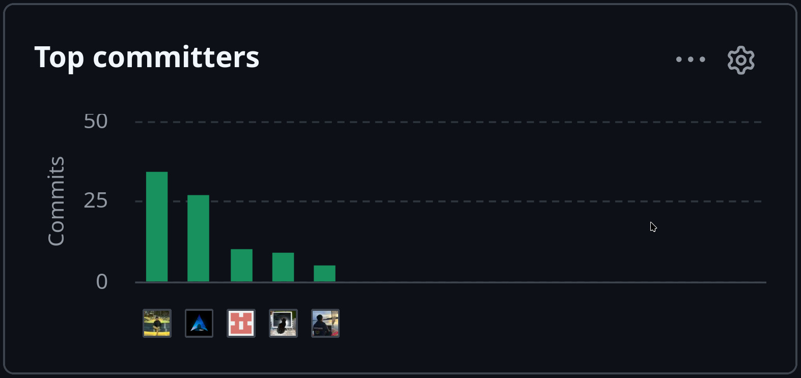

# Project Report Collaboration Insights

Esta sección documenta la infraestructura de repositorios, la metodología de trabajo colaborativo, la distribución equitativa del esfuerzo del equipo **TuxLogic** y las métricas de contribución registradas en la organización de GitHub para la entrega del informe del proyecto (**ShiftIq**).

---

## 1. Enlaces a Repositorios Oficiales del Proyecto

El desarrollo del ecosistema **ShiftIq** se gestiona bajo la organización oficial en GitHub:  
**Organización de GitHub:** [https://github.com/tux-logic](https://github.com/tux-logic)

Como se resume en la Tabla 1, la organización centraliza los repositorios oficiales para el informe del proyecto, la landing page comercial, la plataforma backend y los dos aplicativos móviles desarrollados en el Sprint 2:

**Tabla 1**  
*Repositorios oficiales de la organización TuxLogic en GitHub*

| Repositorio | Descripción / Propósito | Enlace Público |
| --- | --- | --- |
| **Project Report** | Informe académico oficial en formato Markdown (GFM) y Typst PDF. | [https://github.com/tux-logic/upc-pre-202620-1acc0238-13981-TuxLogic-report.git](https://github.com/tux-logic/upc-pre-202620-1acc0238-13981-TuxLogic-report.git) |
| **Landing Page** | Sitio web comercial e informativo del producto ShiftIq. | [https://github.com/tux-logic/Shiftiq-Landing-Page.git](https://github.com/tux-logic/Shiftiq-Landing-Page.git) |
| **Backend API** | Plataforma backend orientada a microservicios bajo Domain-Driven Design (DDD). | [https://github.com/tux-logic/shiftiq-platform.git](https://github.com/tux-logic/shiftiq-platform.git) |
| **ShiftIQ Workshop App (Flutter - B2B)** | Aplicación móvil multiplataforma para dueños y mecánicos de talleres automotrices (Segmento 1). | [https://github.com/tux-logic/shiftiq-mobile-app-flutter](https://github.com/tux-logic/shiftiq-mobile-app-flutter) |
| **ShiftIQ Driver App (Kotlin nativo - B2C)** | Aplicación móvil nativa en Kotlin con Jetpack Compose para conductores particulares (Segmento 2). | [https://github.com/tux-logic/shiftiq-mobile-app](https://github.com/tux-logic/shiftiq-mobile-app) |

---

## 2. Explicación del Proceso de Colaboración y Metodología Git

Para garantizar una trazabilidad rigurosa, la elaboración del informe se rigió bajo las siguientes prácticas de ingeniería de software:

1. **Estrategia de Ramificación (Gitflow):**
   - `main`: Rama de producción donde residen únicamente versiones finales de entrega aprobadas (`v1.0`, `v1.12`).
   - `develop`: Rama principal de integración continua donde se consolidaron los avances del equipo.
   - Ramas de características (`feature/<nombre-caracteristica>`): Ramas aisladas para la redacción y diagramación de secciones específicas del informe (e.g., `feature/team-members-photos`, `feature/fix-c4-diagram-html-labels`, `feature/requirements`).

2. **Control de Calidad mediante Pull Requests (PRs):**
   - Todo cambio hacia la rama `develop` fue sometido a revisión de pares (*Peer Code Review*) mediante solicitudes de extracción en GitHub.
   - Verificación automatizada de sintaxis y compilación sin errores del documento PDF resultante.

3. **Estándar de Commits (Conventional Commits):**
   - Todos los integrantes aplicaron mensajes estructurados con prefijos estandarizados (`feat`, `fix`, `docs`, `style`, `build`, `chore`), facilitando el seguimiento y la audibilidad del proyecto.

---

## 3. Demostración de Participación y Aportes del Equipo

Los 5 integrantes del equipo **TuxLogic** han participado activamente en la construcción del informe, distribuyendo las responsabilidades según sus áreas de especialización. Como se muestra en la Tabla 2, se detallan los roles y contribuciones técnicas de cada miembro:

**Tabla 2**  
*Distribución de roles y aportes individuales en el informe del proyecto*

| Estudiante | Código | Rol Principal | Aportes Principales al Informe (AV1) |
| --- | --- | --- | --- |
| **Machacca Soto, Aldo Jeanfranco** | `u202419485` | Backend & Architecture | Arquitectura DDD (Context Mapping, Bounded Contexts Tácticos), Modelado C4 (Contexto, Contenedores, Despliegue), Pipeline Typst y Automatización SVG. |
| **Mamani Vilca, Alan Jaivi** | `u20241e299` | FinTech Data & Cloud Architecture | Ejecución y registro de las Entrevistas #1 y #2 (Segmento 1 - Talleres), matriz de arquetipos, EventStorming estratégico, Candidate Bounded Context Canvases, Context Mapping, Flujos de Mensajes de Dominio y Modelado C4 (Contexto, Contenedores y Despliegue). |
| **Mallqui Vilca, Dhilsen Armil** | `U202319440` | QA & Requirements | Investigación de Needfinding, Empathy Maps, User Personas e diagramación estructurada de Impact Mapping para ambos segmentos de mercado. |
| **Ramos Hinostroza, Diego Antonio** | `u202224130` | Backend & DevOps | Inicialización del repositorio, redacción del Startup Profile, Solution Profile (Lean UX, 5W's 2H's), Target Segments y registro de versiones inicial. |
| **Vidal Malaga, Jareth Beycker** | `u202316878` | Mobile & Product Owner | Análisis competitivo de mercado, matriz SWOT, estrategias/tácticas frente a competidores, catálogo de 60 User Stories y Product Backlog priorizado. |

---

## 4. Métricas de Colaboración y Analíticos de GitHub

A través de las herramientas de analítica de GitHub (*Insights / Contributors*), se constata la actividad constante del equipo durante el periodo de desarrollo del **Primer Hito (AV1)**, tal como se muestra en la Figura 1:

**Figura 1**  
*Analíticos de colaboración de GitHub e historial de contribuciones del equipo TuxLogic*  

### Resumen de Actividad en GitHub (Hito AV1):
- **Total de Commits:** 370+ commits registrados a través de las ramas de desarrollo e integración.
- **Pull Requests Fusionados:** 16 solicitudes de extracción integradas a la rama `develop`.
- **Nivel de Participación:** 100% de los 5 miembros del equipo registran aportes significativos en código, artefactos y documentación.

---

## 5. Avance Acumulativo del Proyecto

La documentación del informe cubre los hitos desarrollados por el equipo:
- **Entrega AV1 / Primer Hito (30/08/2026 - 16/09/2026):** Definición de la startup, problemática, investigación cualitativa de usuarios y mercado, catálogo de requerimientos con 60 historias de usuario, diagramas de Impact Mapping, modelado EventStorming, Bounded Context Canvases, Context Mapping, Arquitectura C4 y compilación nativa en Typst (`v1.0` – `v1.13`).
- **Entrega TB1 / Segundo Hito (Sprint 1: 17/09/2026 - 10/10/2026):** Desarrollo y publicación de la Landing Page en Vercel, contenedorización y despliegue del Backend RESTful API en Render Cloud, 42 pruebas unitarias con JUnit 5 y documentación interactiva con OpenAPI/Swagger (`v2.0` – `v2.1`).
- **Entrega Final / Tercer Hito (Sprint 2: 12/10/2026 - 12/11/2026):** Desarrollo dual móvil con la aplicación Flutter para talleres (B2B) y la aplicación Kotlin nativa con Jetpack Compose para conductores (B2C), distribución con GitHub Releases y Firebase App Distribution, videos de navegación y evaluaciones de usabilidad según las 10 heurísticas de Nielsen (`v2.2`).

---

## 6. Coherencia Interna con el Registro de Versiones

Toda la información expuesta en esta sección guarda una estricta alineación y coherencia con la tabla del **Registro de Versiones del Informe** (Sección 02), reflejando con exactitud los autores, fechas y descripciones de las modificaciones realizadas desde la versión `v1.0` hasta la versión `v2.2`.
